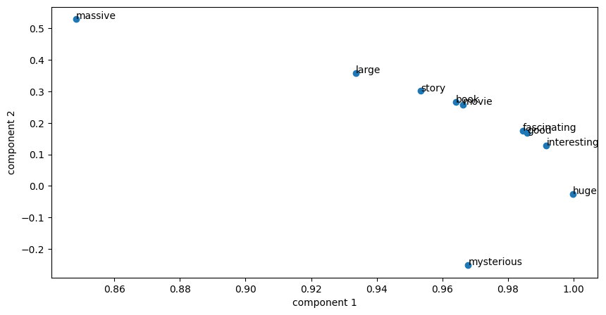
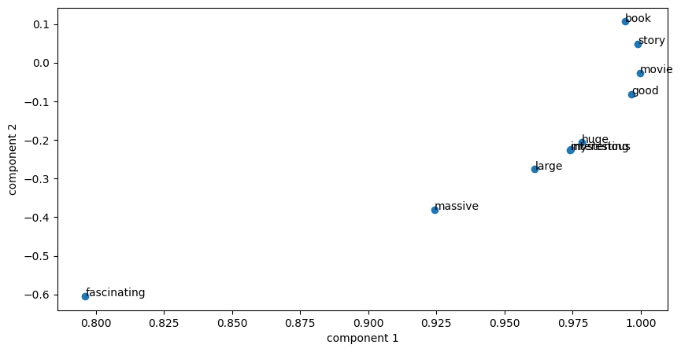

# CS224n Winter2026 A1：Exploring Word Vectors（首轮执行及人工分析完成）

来源为[官方A1发行包](https://web.stanford.edu/class/cs224n/assignments_w26/a1.zip)，92860字节，SHA256 `adbae7acc45bdcdd4bf21c35f25116ca1fc9698140cdcacec458295f9dffe87e`。原始导入cf16c607；当前仓库是官方ZIP镜像，不是独立官方GitHub starter的fork。独立分支`edidada/a1-word-vectors`，独立YAML为a1-word-vectors.yml。

## 实现

在原notebook填写四个函数：按字典序去重；逐文档统计上下文窗口内的有向共现计数；使用n_iter10的TruncatedSVD返回UΣ；仅绘制指定词并标注。共现不跨文档边界，不计当前位置本身，但同一词出现在不同位置的共现会累计到对角线；两种方向均计数，矩阵对称。空语料、零窗口、重复词和边界窗口由独立枚举oracle核对，不通过过滤空token或词频改变原150篇预处理定义。

原四个sanity/test单元源码逐字保持一致，原始README/env及参考图片另固定Git blob SHA。新增验证脚本只存集中`ai_agent_scripts/py/verify_cs224n_vectors.py`，首轮来源6b4d45d、固定数据的更新版012f0a20a525c9f621496279ea7cc5667b68f87f；通过只含本任务源码及provenance的工具ZIP供Actions调用。

## 数据与真实输出计划

完整执行原notebook全部代码单元，保留GloVe wiki-gigaword **400000×200** 全词表，不能以少量候选词或50维模型替代。原150篇IMDB采样不改变；首运行在Actions解析stanfordnlp/imdb实际commit并写入执行副本，再按该commit加载。GloVe原gzip核对gensim官方元数据MD5，并记录实际SHA256；没有提前编造未知资产哈希。

工件应含完整执行notebook、sanity/co-occurrence/GloVe三幅实际图、固定数据revision与模型大小、原始近邻/距离/类比探针，以及独立检查JSON。验证附录只添加到执行副本，明确不属于原始提交题目；原import列表不新增库。环境固定Python3.11、NumPy1.26.4、SciPy1.13.1、Gensim4.3.3、datasets2.18.0等，模型与notebook实验只在Actions执行。

## 实际执行与人工分析

实现提交 `282b0e27c322d0c3d1214ae515d08bda826ca3df` 的 [run45628858770](https://github.com/edidada/cs224n-w26/actions/runs/45628858770) completed/success。24个原始代码单元及1个审计附录全部执行，无error输出；独立320组共现oracle、NumPy SVD参考和指定点/标签检查通过。完整执行notebook在对应Actions工件中。

原语料为25000条train中的前150篇，实际150篇均为label0，词表5880，共现矩阵5880×5880。它不是随机、类别均衡的全量语料，不能把这批采样得出的词关系推广为普遍结论。IMDB已固定实测修订 `e6281661ce1c48d982bc483cf8a173c1bbeb5d31`。完整GloVe 400000×200载入成功，原gzip为264336934字节，官方MD5 `59652db361b7a87ee73834a6c391dfc1`，实际SHA256 `05a24fc412ff2b79bc15f67765fb561182619eef3bfba98bf3f739f33935f07a`；更新版执行器会再次强制核对这一SHA，而非只记录。

三张实际图均已查看，共现与GloVe图另对照官方参考，词的相对位置一致、marker样式不同。图中部分标签重叠，分析同时参考实际坐标，不能把二维距离当作完整200维语义事实。

| 题目 | 实际结果与解释摘要 |
| --- | --- |
| 1.5 | book/movie/story一组，good/fascinating/interesting一组；massive/huge及mysterious/fascinating没有按直觉靠近。已根据真实图说明小语料与投影局限。 |
| 2.1 | book/movie/story在两图仍相近；fascinating在GloVe图成为远离good/interesting的点。语料领域、规模、采样类别、目标函数及降维均不同。 |
| 2.2 | mouse的top10有mice/rat/rabbit/cat和keyboard/cursor/trackball/joystick/clicks，确实覆盖动物与设备；apple和bank本次各主要覆盖技术、金融，未把单义近邻冒充多义成功。 |
| 2.3 | distance(hot,cold)=0.40621883，小于distance(hot,scorching)=0.55771026。反义词也可能共享上下文，邻近不等同同义。 |
| 2.4/2.5(a) | woman+grandfather-man的top1为grandmother（0.76084453）；granddaughter/daughter/mother也接近，说明分布近邻不是精确家谱推理。 |
| 2.5(b) | paris:france :: rome:italy，italy实际top1，cosine similarity 0.77256364。 |
| 2.6(a) | glove+foot-hand实际top1为45,000-square（0.49220327），与foot的长度单位语义相关；没有把预期sock写成实测答案。 |
| 2.6(b) | dog:puppy :: cat:kitten失败，puppies为top1（0.61422449），kitten第二（0.59190696）。 |
| 2.7/2.8 | 实际查看profession偏移及独立doctor偏移：后者女性方向top1为nurse（0.68133187），男性方向top1为dr.（0.54862970）。这是词向量里的语料关联不对称，不是群体能力或职业建议。 |
| 2.9 | 解释语料共现如何引入统计偏见，提出受控反事实数据增强及其语义约束；未声称已重新训练或消除偏见。 |

全部书面答案已写回原notebook的对应Markdown单元，原始sanity源码保持不变。首轮机器指标、原始近邻和三图永久归档于langnote `courses/lab-reports/CS224n-W26-A1-evidence/run-45628858770/`；首轮工件的“written review pending”描述的是当时阶段，不是本次人工审查后的结论。

本次补齐分析、固定已验证的数据修订/模型SHA并更新工具后，新的HEAD仍需完整Actions复验与工件复核再登记最终验收。没有在本地运行notebook或模型；自学代码与文字披露AI辅助，不冒充课堂独立提交。
