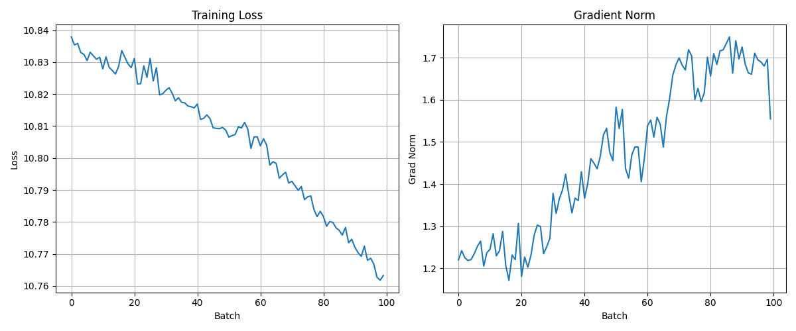

# CS224n Winter2026 A3：Self-Attention与Transformer（实现提交必做实验通过）

依据[官方六页手册](https://web.stanford.edu/class/cs224n/assignments_w26/a3.pdf)及[官方ZIP](https://web.stanford.edu/class/cs224n/assignments_w26/a3.zip)。发行包SHA256 `73f8b3a336f54ae7101698da06bf99df2dac7aa5219c547ad78e397e3ac711df`，原始导入cf16c607；这是发行包镜像，不是独立官方GitHub仓库的fork。独立分支`edidada/a3-transformer`，独立YAML为a3-transformer.yml。

## 1. Attention推导

(a) 若某个分数k_jᵀq超过其余分数足够多，尤其该差距远大于log(n)，softmax的大部分质量落在j，输出接近v_j。只说“该分数最大”不够，因为小差距仍会产生弥散权重。

(b) 对单位正交keys，取`q=λ(k_a+k_b)`，λ足够大。a、b分数均为λ，其余为0，故各权重`e^λ/(2e^λ+n-2)`趋近1/2，输出趋近`(v_a+v_b)/2`。

(c)(i) 小各向同性噪声下取`q=λ(μ_a+μ_b)`，同理近似平均。需同时让λ大以压低非目标项、λ√α小以免放大噪声；例如α趋0时取λ=α^-1/4。不能不加限制地把λ取到无限而仍声称对固定噪声稳定。

(c)(ii) 当a沿μ_a方向出现大模长波动，a与b的分数差也剧烈波动。softmax指数放大差距，输出可能偏向v_a或v_b，而非稳定平均，样本间方差增大；这与所有key仅有极小各向同性噪声不同。

(d)(i) 两头分别取`q_1=λμ_a`、`q_2=λμ_b`，各自近似复制v_a、v_b，再平均。

(d)(ii) 按题意忽略a投影变负的情况，第一头仍主要选择a，第二头主要选择b；a模长变化不再直接与b竞争同一个softmax分母的领先地位，因此两输出和最终平均更稳定。有限λ且a分数极接近0时仍有误差，不能声称对任意协方差都严格零方差。

(e) 多头把不同信息检索分开归一化与选择，减少单头必须用相同softmax质量预算在多个目标之间折中的问题；最后的输出投影再组合各头信息。

## 2. 位置编码

(a)(i) 对排列矩阵P，`Q'=PQ,K'=PK,V'=PV`，于是分数矩阵为`PAPᵀ`。利用给定softmax性质，`H'=P softmax(A)Pᵀ PV=PH`。又有`P1=1`，广播偏置与P可交换，ReLU逐行作用，故`Z'=PZ`。这是题设未加因果mask、位置编码的简化网络；不能不加说明推广到固定三角mask的解码器。

(a)(ii) 该网络无法区分纯粹由词序而产生的结构差异，只随排列重排输出；自然语言中主客体、修饰关系与语义依赖顺序，因此需要位置信息。

(b)(i) 对固定位置表Φ，打乱token得到`PX+Φ`，一般不同于`P(X+Φ)=PX+PΦ`，因此位置表破坏上述排列等变性，使模型可利用词序。

(b)(ii) 在题设整数位置、精确实数运算下，不同位置的完整编码不会相同：仅第一对sin(t)、cos(t)同时相等就要求`t-s=2πk`，而不同整数t、s不满足该条件。重复出现的同一词在不同位置也有不同位置编码。极长位置或有限浮点精度可能出现近似混淆，这不等于数学上严格相同；单个正弦分量周期性也不能证明整个向量相同。

## 3. 实现与实验范围

实现六个函数：MLP两层及原始GELU；各头Q/K/V与按head_dim缩放、下三角mask和softmax的attention；两个pre-LN残差分支；token与位置embedding、逐层backbone和最终LN/logits；批量贪心生成；右移目标的下一词交叉熵。生成保留原prompt，超过context时仅裁剪计算用窗口；负生成长度、空prompt及不足两词的loss明确报错。

原六份测试及所有快照保持原样，并固定原始utils和测试资源SHA。补充验证包括原生SDPA参考、前缀不受未来输入影响、未来输入梯度为0、移除mask受控负例、独立shifted-loss及未shift负例、全参数有限梯度、批量argmax/零生成/上下文裁剪。额外加载完整GPT-2权重与HuggingFace参考对比全部词表logits；模型及tokenizer固定`openai-community/gpt2`修订607a30d783dfa663caf39e06633721c8d4cfcd7e。这不等于从零训练过GPT-2。

必做训练严格保留原配置：d_model33、heads3、layers3、context512、vocab50257、batch16、lr1e-5、clip1、100步，使用原函数选择TinyStories train首1%并按原方式分块。数据修订先解析成实际40位commit，再按该commit加载和记录；首次解析不是预先固定的官方checksum。缓存名改为真实的1pct并含revision，避免原代码10pct文件名误导和跨版本串缓存；不改变原取样比例或分块逻辑。保留100次loss、梯度范数、真实曲线、数据缓存/图像/模型权重哈希。

所有新增Python仅放集中工具库`py/verify_cs224n_transformer.py`，固定来源4d99fb0a12c99d97beb0560ffa7fa19aa04b26d2，通过带provenance的本任务ZIP公开发布。训练与模型测试只在GitHub Actions运行，本地只有源码、AST与哈希检查。

## 首次实际运行与工件复核

实现提交 `bb7230e4c3aa4edf7b4ba48dd013c41201fd048e` 的 [run45626368108](https://github.com/edidada/cs224n-w26/actions/runs/45626368108) completed/success。原始6项快照零失败/错误/跳过，补充检查全部通过；固定GPT-2转换后，两条6-token输入的全部词表logits与参考最大绝对误差为0.0。这只覆盖实际测试输入，不证明所有可能输入均无误差，也不是从零训练GPT-2。

TinyStories实际修订为 `f54c09fd23315a6f9c86f9dc80f725de7d8f9c64`，当前YAML已显式固定它，后续不再依赖main解析。原首1%预处理得到9049个512-token块；实际按原配置训练100步。全部loss和梯度范数有限，前10步loss均值10.83325071，后10步10.76754246，末步10.76325798。损失总体下降但不逐步单调；绝对下降有限，不能据此声称具备良好语言生成质量或验证集泛化能力。

图像已实际打开查看：损失前段有波动，随后总体降低；梯度范数约1.1715–1.7495。后者是clip_grad_norm_返回的裁剪前范数，不是裁剪后实测值；阈值配置为1，不能因曲线大于1就判剪裁无效。纵轴缩放显示细小变化，不应当作大幅改善。

完整工件已下载并核对实际图像和baseline.weights SHA。曲线SHA256 `22aa5015520af6d1201ce254b7a6615d417e92b2ab428aff77eeca353662dc9e`，权重 `66b2dc6a63467d3f41f50f514dea4e018f10f3de1463f0e763b8401633779df4`。数据缓存不在该工件内，其SHA只由远端记录，没有冒称本地重新核验缓存。原始JSON、JUnit、曲线和下载审计归档到langnote `courses/lab-reports/CS224n-W26-A3-evidence/run-45626368108/`。

本次补充报告并固定相同的数据修订，更新后的HEAD还须自身CI复验；上述数值严格属于所列实现run。三项累积改进bonus为可选项，本次不包含它们，也不据基线下降宣称取得加分。自学代码与推导披露AI辅助，不冒充独立课堂提交或私有评阅结果。
